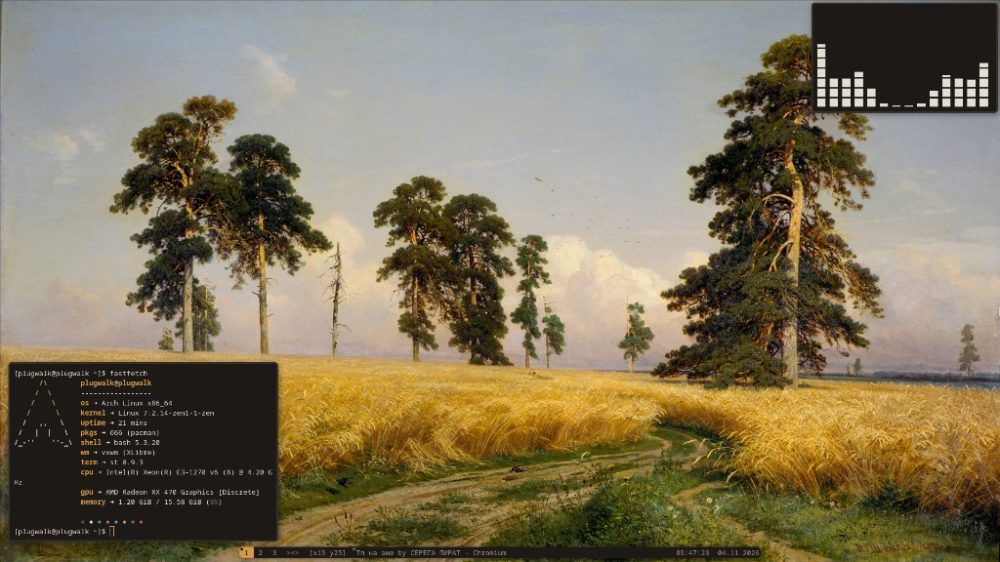

# packages

- [vxwm](https://codeberg.org/wh1tepearl/vxwm)
- [st](https://git.suckless.org/st)
- [dmenu](https://git.suckless.org/dmenu)
- [picom-ftlabs](https://github.com/FT-Labs/picom)
- [dunst](https://github.com/dunst-project/dunst)
- [j4-dmenu-desktop](https://github.com/enkore/j4-dmenu-desktop)
- [pcmanfm](https://github.com/lxde/pcmanfm)
- [feh](https://github.com/derf/feh)
- [maim](https://github.com/naelstrof/maim)
- [xclip](https://github.com/astrand/xclip)
- [lightdm](https://github.com/canonical/lightdm)
- [lightdm-mini-greeter](https://github.com/prikhi/lightdm-mini-greeter)
- [pipewire](https://gitlab.freedesktop.org/pipewire/pipewire)
- [wireplumber](https://gitlab.freedesktop.org/pipewire/wireplumber)
- [xsetroot](https://gitlab.freedesktop.org/xorg/app/xsetroot)

# how to install

```bash
# dependencies
sudo pacman -S --needed feh maim xclip j4-dmenu-desktop dunst pcmanfm xsettingsd fastfetch
yay -S --needed picom-ftlabs-git

# suckless ^^
for d in suckless/*; do sudo make -C "$d" clean install; done

# configs & scripts
sudo cp bin/* /usr/local/bin/
cp -r config/* ~/.config/
cp config/xinitrc ~/.xinitrc
cp -r wallpapers ~/.config/
feh --bg-fill ~/.config/wallpapers/shishkin.jpg
sudo cp config/lightdm/vxwm.desktop /usr/share/xsessions/
```

# hotkeys

| Key | Action |
|---|---|
| `Print` | fullscreen screenshot to clipboard |
| `Shift + Print` | area screenshot to clipboard |
| `XF86AudioRaiseVolume` / `Super + F3` | volume up (+5%) |
| `XF86AudioLowerVolume` / `Super + F2` | volume down (-5%) |
| `XF86AudioMute` / `Super + F1` | Toggle mute |
| `Alt + Shift` | switch keyboard layout (US / RU) |
